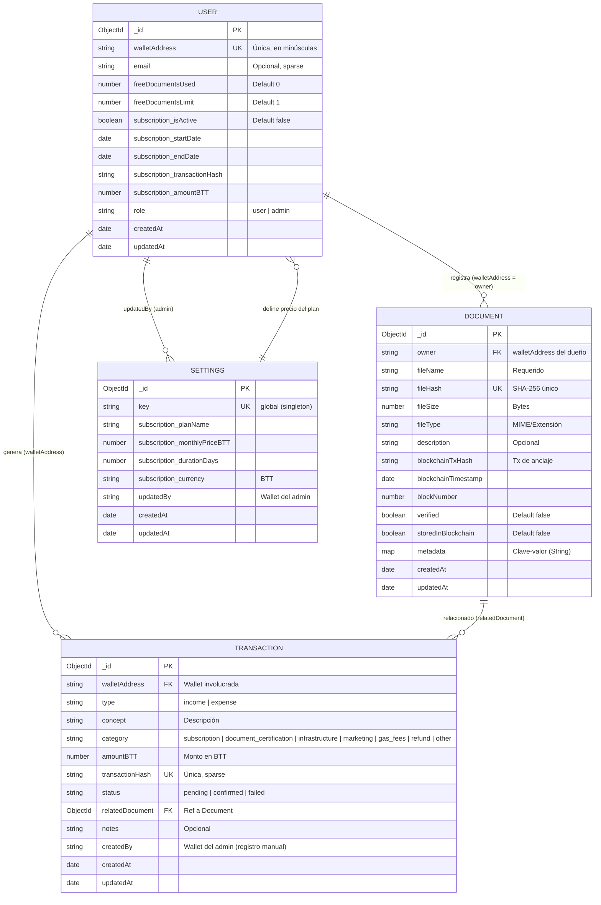
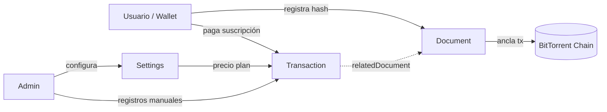

# Modelo Entidad-Relación — App Verify Documents

Aplicación de verificación y certificación de documentos en blockchain (BitTorrent Chain), con autenticación por wallet, suscripciones y panel de administración.

**Base de datos:** MongoDB (Mongoose) — 4 colecciones principales.

---

## 1. Diagrama Entidad-Relación



---

## 2. Entidades y atributos

### 2.1 User (`server/src/models/User.js`)

Identifica a cada usuario por su dirección de wallet (no hay contraseña; la identidad es on-chain).

| Atributo | Tipo | Restricciones | Descripción |
|---|---|---|---|
| `_id` | ObjectId | PK | Identificador Mongo |
| `walletAddress` | String | UNIQUE, requerido, lowercase | Wallet de la blockchain |
| `email` | String | Opcional, sparse, lowercase | Correo de contacto |
| `freeDocumentsUsed` | Number | Default 0 | Documentos gratuitos usados |
| `freeDocumentsLimit` | Number | Default 1 | Cuota gratuita (el admin puede cambiarla) |
| `subscription.isActive` | Boolean | Default false | Suscripción vigente |
| `subscription.startDate` | Date | — | Inicio de suscripción |
| `subscription.endDate` | Date | — | Vencimiento |
| `subscription.transactionHash` | String | — | Tx blockchain del pago |
| `subscription.amountBTT` | Number | — | Monto pagado en BTT |
| `role` | String | Enum: `user`, `admin` | Rol del usuario |
| `createdAt` / `updatedAt` | Date | Auto | Auditoría |

### 2.2 Document (`server/src/models/Document.js`)

Huella digital de un documento anclado en blockchain.

| Atributo | Tipo | Restricciones | Descripción |
|---|---|---|---|
| `_id` | ObjectId | PK | Identificador Mongo |
| `owner` | String | Requerido, lowercase | Wallet del dueño (lógica FK a `User.walletAddress`) |
| `fileName` | String | Requerido | Nombre original del archivo |
| `fileHash` | String | UNIQUE, requerido | Hash SHA-256 del contenido |
| `fileSize` | Number | Requerido | Tamaño en bytes |
| `fileType` | String | Requerido | Tipo/extension del archivo |
| `description` | String | Opcional | Descripción del documento |
| `blockchainTxHash` | String | — | Tx del anclaje on-chain |
| `blockchainTimestamp` | Date | — | Fecha del anclaje |
| `blockNumber` | Number | — | Bloque de la transacción |
| `verified` | Boolean | Default false | Verificado exitosamente |
| `storedInBlockchain` | Boolean | Default false | Anclado en blockchain |
| `metadata` | Map\<String,String> | — | Metadatos arbitrarios |
| `createdAt` / `updatedAt` | Date | Auto (hook pre-save) | Auditoría |

**Índices:** `{owner, createdAt:-1}`, `{fileHash}`.

### 2.3 Transaction (`server/src/models/Transaction.js`)

Libro de ingresos/egresos en BTT (suscripciones, certificaciones, gastos operativos).

| Atributo | Tipo | Restricciones | Descripción |
|---|---|---|---|
| `_id` | ObjectId | PK | Identificador Mongo |
| `walletAddress` | String | Requerido, lowercase, indexado | Wallet asociada (lógica FK a `User.walletAddress`) |
| `type` | String | Enum: `income`, `expense` | Tipo de movimiento |
| `concept` | String | Requerido, trim | Descripción del movimiento |
| `category` | String | Enum: `subscription`, `document_certification`, `infrastructure`, `marketing`, `gas_fees`, `refund`, `other` | Categoría |
| `amountBTT` | Number | Requerido, min 0 | Monto en BTT |
| `transactionHash` | String | UNIQUE sparse | Hash de la tx on-chain |
| `status` | String | Enum: `pending`, `confirmed`, `failed` | Estado |
| `relatedDocument` | ObjectId | FK → Document | Documento vinculado (opcional) |
| `notes` | String | Opcional | Notas internas |
| `createdBy` | String | lowercase | Wallet del admin que registró |
| `createdAt` / `updatedAt` | Date | Auto | Auditoría |

**Índices:** `{type, createdAt:-1}`, `{walletAddress, createdAt:-1}`, `{transactionHash}` único sparse.

### 2.4 Settings (`server/src/models/Settings.js`)

Documento singleton de configuración global (plan de suscripción).

| Atributo | Tipo | Restricciones | Descripción |
|---|---|---|---|
| `_id` | ObjectId | PK | Identificador Mongo |
| `key` | String | UNIQUE, default `global` | Clave del documento único |
| `subscription.planName` | String | Default "Suscripción mensual" | Nombre del plan |
| `subscription.monthlyPriceBTT` | Number | min 0, default desde env (1000) | Precio mensual en BTT |
| `subscription.durationDays` | Number | min 1, default 30 | Duración del plan |
| `subscription.currency` | String | Default `BTT` | Moneda |
| `updatedBy` | String | lowercase | Wallet del admin que editó |
| `createdAt` / `updatedAt` | Date | timestamps automático | Auditoría |

---

## 3. Relaciones

| # | Relación | Cardenalidad | Clave de unión | Regla de negocio |
|---|---|---|---|---|
| R1 | User → Document | 1:N | `User.walletAddress` = `Document.owner` | Un usuario puede registrar muchos documentos. El hash `fileHash` es globalmente único (un documento no puede duplicarse). |
| R2 | User → Transaction | 1:N | `User.walletAddress` = `Transaction.walletAddress` | Cada pago de suscripción o gasto genera transacciones para una wallet. |
| R3 | Document → Transaction | 1:N | `Transaction.relatedDocument` (ObjectId ref) | Una transacción de tipo `document_certification` puede referenciar el documento certificado. Opcional (N:0..1 desde Transaction). |
| R4 | User (admin) → Settings | 1:1 (singleton) | `Settings.updatedBy` | El admin configura precio/duración del plan; se copia al snapshot `subscription` del User al activarse. |
| R5 | User → Document (cuota) | 1:N derivado | `freeDocumentsUsed` vs `freeDocumentsLimit` | Control de documentos gratuitos por usuario antes de requerir suscripción. |

**Nota de diseño:** las FK `owner` y `walletAddress` son referencias lógicas por string (no `ObjectId ref`), salvo `relatedDocument` que usa `ref: 'Document'`. Esto permite operar con wallets que aún no tienen documento `User` (se crea on-demand con `findOrCreate` en los controladores).

---

## 4. Modelo lógico equivalente (SQL)

Para referencia, el mapeo relacional normalizado sería:

```sql
CREATE TABLE users (
  wallet_address    VARCHAR(64) PRIMARY KEY,
  email             VARCHAR(255) UNIQUE,
  free_documents_used  INT NOT NULL DEFAULT 0,
  free_documents_limit INT NOT NULL DEFAULT 1,
  role              VARCHAR(10) NOT NULL DEFAULT 'user' CHECK (role IN ('user','admin')),
  created_at        DATETIME, updated_at DATETIME
);

CREATE TABLE subscriptions (
  wallet_address    VARCHAR(64) PRIMARY KEY REFERENCES users(wallet_address),
  is_active         BOOLEAN DEFAULT FALSE,
  start_date        DATETIME, end_date DATETIME,
  transaction_hash  VARCHAR(80), amount_btt DECIMAL(20,8)
);

CREATE TABLE documents (
  id                BIGINT AUTO_INCREMENT PRIMARY KEY,
  owner             VARCHAR(64) NOT NULL REFERENCES users(wallet_address),
  file_name         VARCHAR(500) NOT NULL,
  file_hash         VARCHAR(64) NOT NULL UNIQUE,
  file_size         BIGINT NOT NULL,
  file_type         VARCHAR(100) NOT NULL,
  description       TEXT,
  blockchain_tx_hash VARCHAR(80),
  blockchain_timestamp DATETIME,
  block_number      BIGINT,
  verified          BOOLEAN DEFAULT FALSE,
  stored_in_blockchain BOOLEAN DEFAULT FALSE,
  created_at        DATETIME, updated_at DATETIME,
  INDEX idx_owner_created (owner, created_at DESC)
);

CREATE TABLE transactions (
  id                BIGINT AUTO_INCREMENT PRIMARY KEY,
  wallet_address    VARCHAR(64) NOT NULL REFERENCES users(wallet_address),
  type              VARCHAR(7) CHECK (type IN ('income','expense')),
  concept           VARCHAR(255) NOT NULL,
  category          VARCHAR(30),
  amount_btt        DECIMAL(20,8) NOT NULL,
  transaction_hash  VARCHAR(80) UNIQUE,
  status            VARCHAR(9) DEFAULT 'confirmed',
  related_document  BIGINT NULL REFERENCES documents(id),
  notes             TEXT,
  created_by        VARCHAR(64) REFERENCES users(wallet_address),
  created_at        DATETIME, updated_at DATETIME
);

CREATE TABLE settings (
  `key`             VARCHAR(30) PRIMARY KEY DEFAULT 'global',
  plan_name         VARCHAR(100),
  monthly_price_btt DECIMAL(20,8),
  duration_days     INT,
  currency          VARCHAR(10),
  updated_by        VARCHAR(64) REFERENCES users(wallet_address)
);
```

---

## 5. Diagrama de contexto (resumen)


